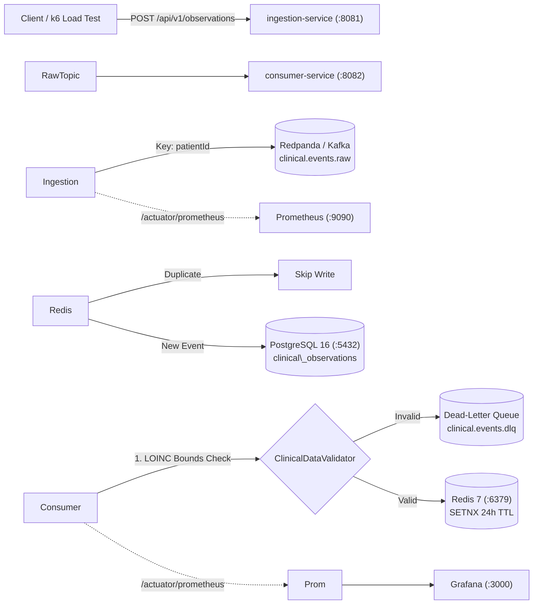

# Distributed Event-Driven Clinical Data Pipeline

A fault-tolerant, high-throughput microservices pipeline for ingesting, validating, deduplicating, and persisting clinical vital sign observations in real time. Built with **Java 17**, **Spring Boot 3**, **Kafka (Redpanda)**, **Redis**, **PostgreSQL**, **Prometheus**, and **Grafana**.

## Architecture



### Key Architectural Decisions

* **Per-Patient Partition Ordering**: `ingestion-service` keys every Kafka message by `patientId`, guaranteeing strict chronological ordering per patient across partitions.
* **Header-Agnostic Decoupling**: Producers disable Spring Kafka `\_\_TypeId\_\_` headers (`spring.json.add.type.headers: false`) and consumers deserialize directly into local DTOs (`spring.json.use.type.headers: false`), preventing tight coupling between microservice package structures.
* **Distributed Idempotency**: `consumer-service` performs an atomic Redis `SETNX` (`setIfAbsent` with a 24-hour TTL) on `eventId` before persisting to PostgreSQL, preventing duplicate writes under retries or concurrent delivery.
* **Non-Blocking Poison Pill Recovery**: Out-of-bounds clinical values throw `InvalidClinicalDataException`, which is marked non-retryable in `DefaultErrorHandler` and routed immediately by `DeadLetterPublishingRecoverer` to `clinical.events.dlq` without stalling partition consumption.

## Tech Stack

|Layer|Technology|
|-|-|
|**Services**|Java 17, Spring Boot 3, Spring Web, Spring for Apache Kafka, Spring Data JPA, Spring Data Redis|
|**Messaging**|Redpanda (Kafka-compatible broker), Redpanda Console|
|**Storage \& Cache**|PostgreSQL 16, Redis 7|
|**Observability**|Micrometer, Spring Boot Actuator, Prometheus, Grafana|
|**Testing \& Load**|JUnit 5, Testcontainers (Kafka, PostgreSQL, Redis), Awaitility, k6|

## Project Structure

```text
clinical-data-pipeline/
├── docker-compose.yml       # Redpanda, Console, PostgreSQL, Redis, Prometheus, Grafana
├── prometheus.yml           # 2s scrape config for ingestion-service and consumer-service
├── ingestion-service/       # REST API (:8081) -> Kafka producer
├── consumer-service/        # Kafka consumer (:8082) -> Validator, Redis, PostgreSQL, DLQ
├── load-tests/
│   └── script.js            # k6 load test (80% valid, 15% duplicate, 5% poison pill)
└── docs/                    # Architecture \& Grafana dashboard screenshots
```

## Quick Start

### 1\. Start Infrastructure

```bash
docker compose up -d
```

|Service|URL|Credentials|
|-|-|-|
|Redpanda Console|`http://localhost:8085`|—|
|Prometheus|`http://localhost:9090`|—|
|Grafana|`http://localhost:3000`|`admin` / `admin`|

### 2\. Run the Microservices

Start each service in a separate terminal:

```bash
# Terminal 1: Ingestion Service (port 8081)
cd ingestion-service
./mvnw spring-boot:run

# Terminal 2: Consumer Service (port 8082)
cd consumer-service
./mvnw spring-boot:run
```

### 3\. Send a Test Observation

```bash
curl -X POST http://localhost:8081/api/v1/observations \\
  -H "Content-Type: application/json" \\
  -d '{
    "eventId": "evt-2026-001",
    "patientId": "pat-10492",
    "code": "8480-6",
    "display": "Systolic Blood Pressure",
    "value": 128.5,
    "unit": "mmHg",
    "effectiveTime": "2026-11-04T18:10:00Z"
  }'
```

* **Valid payload**: Returns `202 Accepted` with `{"status":"ACCEPTED","eventId":"evt-2026-001"}`.
* **Invalid payload** (e.g., blank `patientId`): Rejected at the API boundary with `400 Bad Request` via Jakarta Bean Validation.

## Clinical Validation Rules (LOINC)

`ClinicalDataValidator` enforces finite numeric values and LOINC-specific physiological bounds before any database write:

|LOINC Code|Observation|Unit|Valid Range|
|-|-|-|-|
|`8480-6`|Systolic Blood Pressure|`mmHg`|`20.0 – 350.0`|
|`8462-4`|Diastolic Blood Pressure|`mmHg`|`10.0 – 250.0`|
|`8478-0`|Mean Blood Pressure|`mmHg`|`15.0 – 280.0`|
|`8867-4`|Heart Rate|`/min`|`10.0 – 300.0`|
|`9279-1`|Respiratory Rate|`/min`|`2.0 – 120.0`|
|`8310-5`|Body Temperature|`Cel`|`25.0 – 45.0`|
|`2708-6`|Oxygen Saturation in Arterial Blood|`%`|`30.0 – 100.0`|
|`29463-7`|Body Weight|`kg`|`0.3 – 500.0`|
|`8302-2`|Body Height|`cm`|`20.0 – 260.0`|
|`39156-5`|Body Mass Index (BMI)|`kg/m2`|`5.0 – 150.0`|

Unmapped observation codes fall back to a non-negative baseline check (`value >= 0.0`).

## Testing

Both services include automated integration tests backed by ephemeral **Testcontainers** (Kafka, PostgreSQL, and Redis) plus fast unit tests.

```bash
# Run ingestion-service integration tests
cd ingestion-service
./mvnw test

# Run consumer-service unit and integration tests
cd ../consumer-service
./mvnw test
```

### Verified Scenarios

* **End-to-End Ingestion**: Validates `202 Accepted` / `400 Bad Request` handling and verifies Kafka message key partitioning by `patientId`.
* **Persistence \& Idempotency**: Verifies PostgreSQL writes and Redis `processed\_event:<eventId>` key creation.
* **Concurrent Race Condition**: Fires 10 identical events simultaneously across 10 threads and asserts exactly 1 database row is written.
* **DLQ \& Partition Recovery**: Sends an out-of-bounds observation followed immediately by a valid observation on the same `patientId` partition, asserting the poison pill routes to `clinical.events.dlq` while the valid event persists normally.
* **Parameterized Validator Suite**: JUnit 5 `@ParameterizedTest` covering LOINC boundaries, `null`, `NaN`, and `Infinity`.

## Performance \& Load Testing

Benchmarked locally using **k6** (`load-tests/script.js`) ramping up to 30 concurrent virtual users over 45 seconds (80% unique observations, 15% duplicate event IDs, 5% out-of-bounds poison pills):

```bash
docker run --rm -i --add-host=host.docker.internal:host-gateway grafana/k6 run - < load-tests/script.js
```

|Metric|Measured Result|
|-|-|
|**Total Requests**|`168,162`|
|**Sustained Throughput**|`3,736.93 req/sec`|
|**Success Rate (`202 Accepted`)**|`99.98%` (`168,132 / 168,162`)|
|**Median Latency**|`1.13 ms`|
|**Average Latency**|`1.34 ms`|
|**p95 Latency**|`2.56 ms`|

### Custom Prometheus Metrics

`consumer-service` exposes custom Micrometer counters and percentile histograms on `/actuator/prometheus`:

* `clinical\_events\_persisted\_total`: Valid observations written to PostgreSQL.
* `clinical\_events\_duplicates\_total`: Duplicate events intercepted by Redis.
* `clinical\_events\_invalid\_total`: Invalid observations routed to `clinical.events.dlq`.
* `clinical\_events\_processing\_duration\_seconds`: End-to-end consumer processing latency histogram.

### Screenshots

[docs/grafana-dashboard.png]

[docs/redpanda-clinical-events-raw.png]

[docs/redpanda-clinical-events-dlq.png]
